# User guide

Language: EN | [FR](USER_GUIDE.md)

HeelonVault keeps your secrets in a local database. This guide follows everyday tasks; visible actions depend on your account role, vault permissions and activated edition.

Screenshots show **real production components on Linux**, assembled in test scenarios with a demonstration database and fictitious data, not in a real user session. Vault and editor views illustrate their components without necessarily reproducing the entire window or every header element. Appearance, file pickers and some integrations may differ on Windows and macOS: these screenshots are not validation on those platforms.

## Get started

1. Open HeelonVault from your system's application launcher.
2. On first launch, follow the wizard to create the initial administrator account and choose a strong master password.
3. Record the **24-word recovery phrase**, in order, on a safe medium separate from your computer. Do not share it.
4. Finish the wizard, then sign in with the account you created. Creating the account does not automatically open a session.
5. Select a vault or create one before adding your secrets.
6. From **Profile & Security**, export an encrypted `.hvb` backup and keep it off this computer.

**Prepare now:** the phrase protects recovery, but does not contain your data. The recovery workflow offered at sign-in requires **the `.hvb` file and its matching phrase**. See [Back up and restore](#import-back-up-and-restore).

For subsequent sign-ins, enter your username and master password. If two-factor authentication is enabled, also supply the TOTP code from your authenticator app.

## Find your way around

- **Sidebar:** select a vault, open the trash, security center and profile; administration entries depend on your permissions.
- **Main area:** search, filter, sort and browse secrets within the selected scope.
- **Window controls:** add a secret, change the layout and monitor clipboard-related exposure; component screenshots do not necessarily show all these elements.
- **Editor and profile pages:** work without losing sidebar navigation, then return to your entries.

**Cards** and **list** show the same secrets and use the same search and filtering logic. Choose cards for visual browsing or the list for a more compact view.

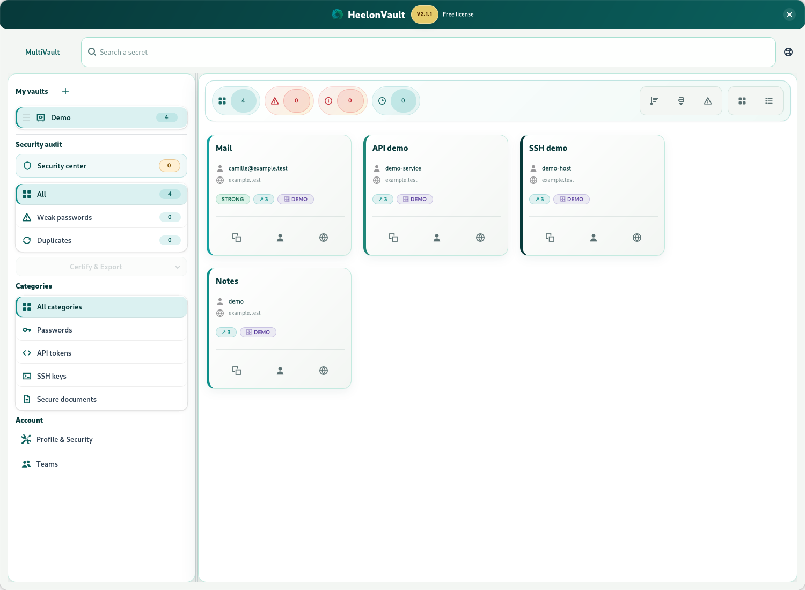

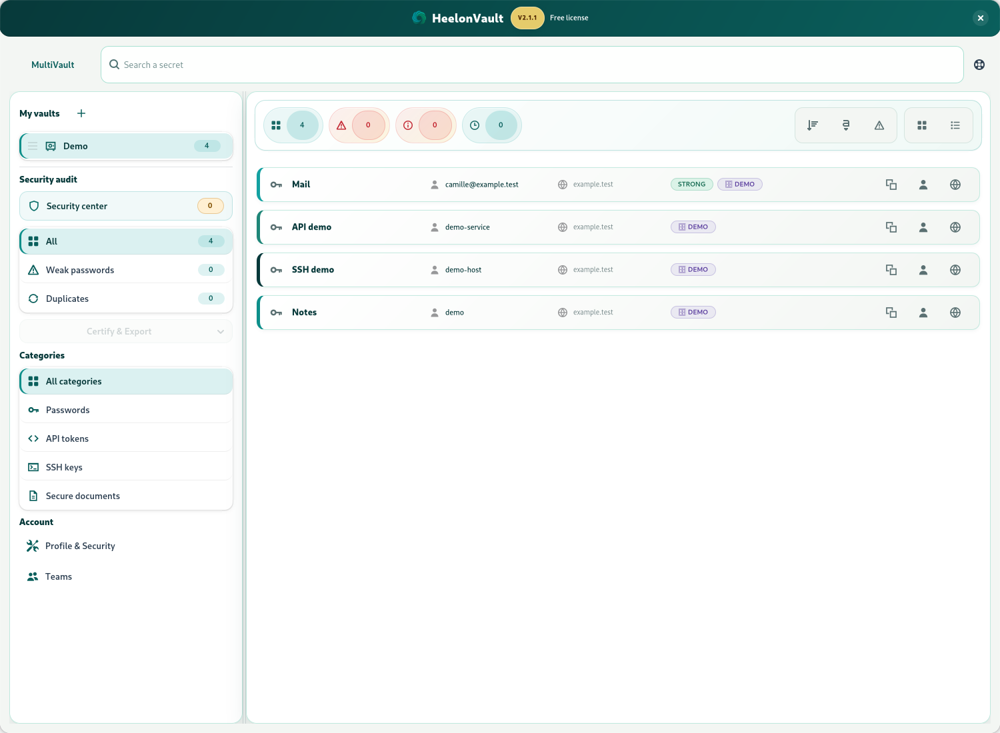

## Create and use the four secret types

### Add an entry

1. Choose the destination vault, then the add action.
2. Select the type and enter a title and the required value.
3. Complete useful fields: login, URL, notes, category, tags or validity, as offered by the form.
4. Save, then check that the entry appears in the correct vault.

| Type | What to enter | Important |
| --- | --- | --- |
| **Password** | Password, login and account information | Use the generator and strength indicator; prefer a unique value for each service. |
| **API token** | Token and provider | Changing a token in HeelonVault does not renew it with the provider. |
| **SSH key** | Private key; public key and passphrase if needed | Do not confuse the public key you distribute with the private key you must protect. |
| **Secure document** | Document path and optional MIME type | The current form stores the **path as the secret value**, not the file's contents. It is not an encrypted attachment or a document backup. |

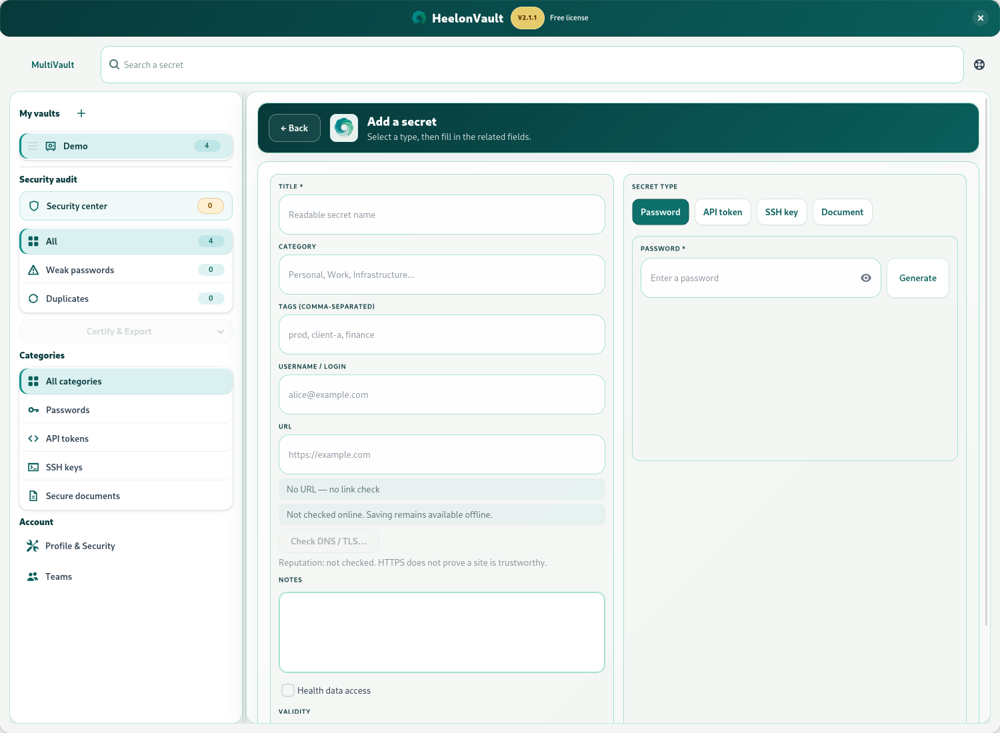

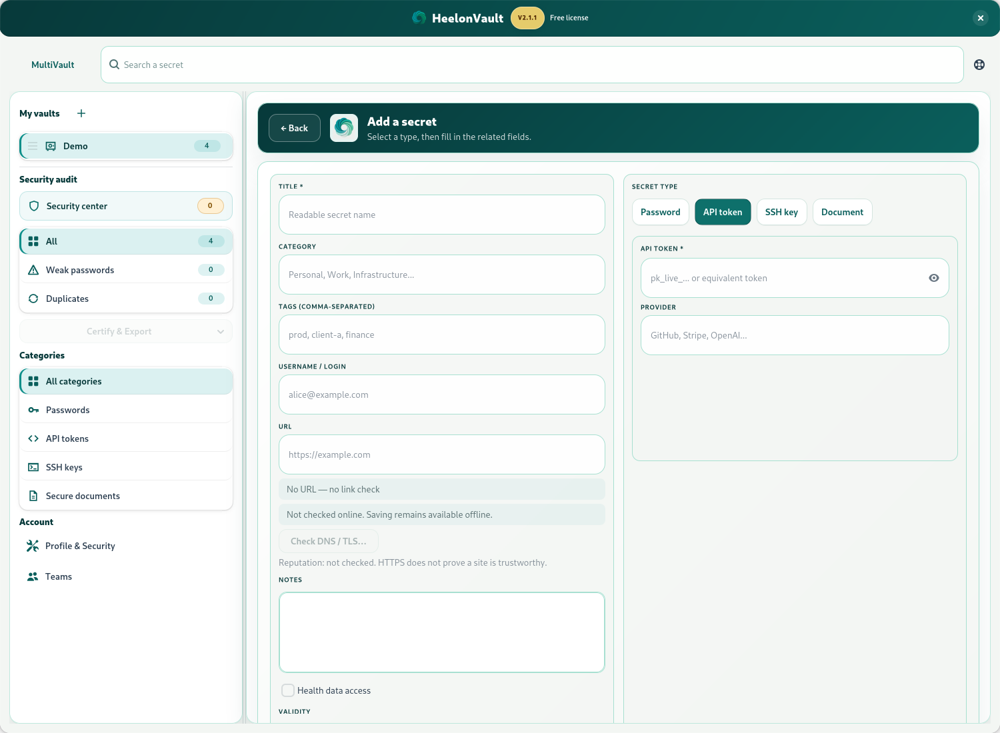

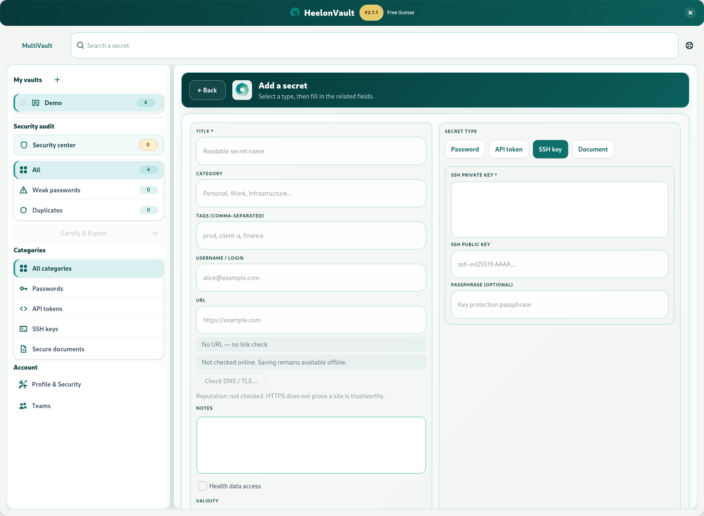

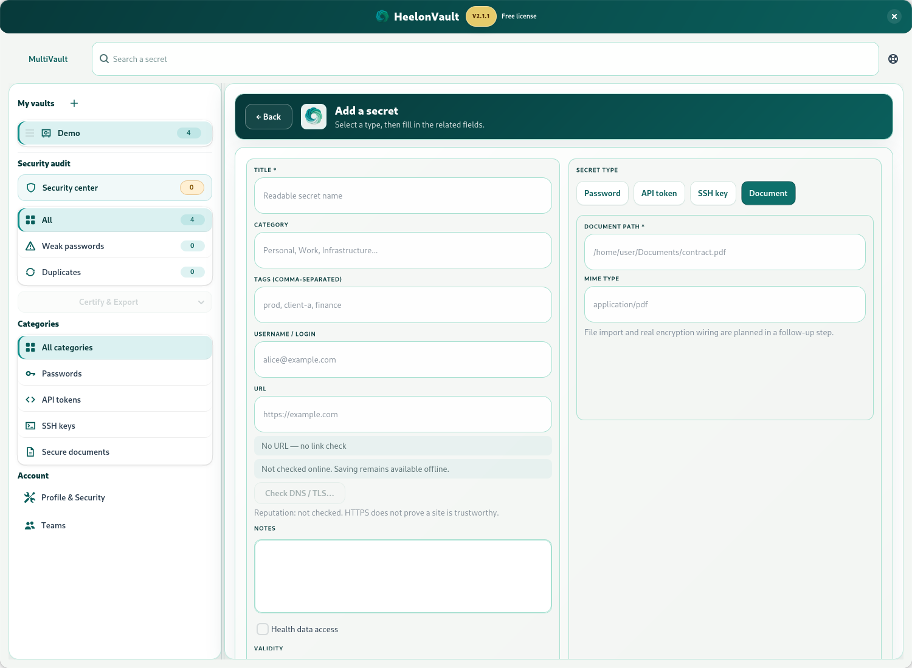

### View, copy and edit

Open an entry to edit it. Prefer copy actions to leaving a sensitive value visible. Copying a password decrypts it on demand and rechecks access to the vault.

The clipboard indicator reports copies tracked by HeelonVault and their clearing countdown; click it to clear immediately. It does not guarantee the absence of secrets elsewhere in memory or the removal of clipboard history and copies already made by other applications.

A validity date helps identify entries that need renewing: it does not revoke credentials at the external service. Change the secret on that service first, then update the entry.

### Delete or recover a deleted entry

Deleting a secret moves it to the **trash**. Open the trash to restore the entry or delete it permanently. **Empty trash** is irreversible in the current database; an earlier backup, if available, is a separate recovery option.

## Search and organize

Search uses the **active vault** by default. Enable **MultiVault** to search across vaults you can access. Searching does not grant additional permissions.

Plain terms search the title, login, email, URL, notes, category, tags, type and vault name. Matching is case-insensitive and normalizes common accented characters; sufficiently long terms have light typo tolerance. Search does not inspect decrypted secret values.

| Example | Purpose |
| --- | --- |
| `mail` | Find a term in entry information |
| `email:example.com` | Limit the term to the email field |
| `tag:work` | Search tags |
| `type:api` | Search a secret type |
| `vault:team` | Restrict by vault name within the loaded scope |
| `title:portal login:alice` | Combine criteria |
| `#health` or `#sante` | Find healthcare-related accounts (medical services, health insurance…), not security findings |

The prefixes `url:`, `notes:` and `category:` are also available. Combine search with filters, sorting and vault selection; if results are empty, first remove filters and check the scope.

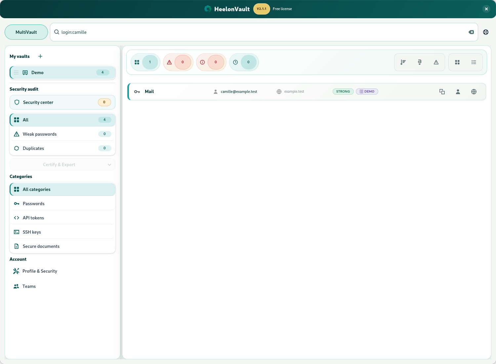

**Shortcuts:** `Ctrl+F` focuses search. While the secret list has focus, arrow keys move the selection; `Ctrl+C` copies the password, `Ctrl+L` the login and `Ctrl+U` opens the URL when the action is available. Command can replace Ctrl depending on the platform. These actions should not intercept typing in a form.

## Review the security center

1. Open the **Security center**.
2. Choose **Analyze my vaults**; you can cancel the scan.
3. Review findings, their source vaults and scan coverage.
4. Open an affected entry to prepare a correction, then run the analysis again after editing.

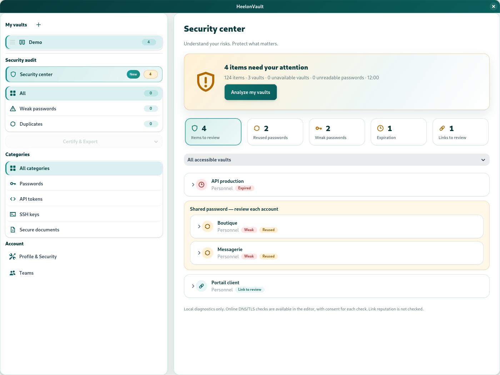

The illustrated security center uses a different demonstration scenario from the vault views. Its findings therefore do not correspond to the counters in the vault screenshots, which may show zero; these are not the same analysis before and after corrections.

The analysis runs **locally, without network requests**, across accessible vaults. It identifies weak or reused passwords, expired or soon-to-expire entries, invalid dates or metadata, unreadable values and URLs needing attention.

An unavailable vault or unreadable password makes coverage incomplete: missing data must not be treated as healthy. No findings is neither proof of absence of compromise nor a compliance certification.

To fix a reused password, expired token or exposed key, **change or revoke it on the relevant service first**, then update HeelonVault. Editing only the local entry does not secure the remote account.

## Manage your account, session and recovery

### Set up your profile

Open **Profile & Security** to edit the available account information, change your master password, choose a language and adjust protections. The sign-in username cannot be changed. Language changes apply immediately throughout the interface.

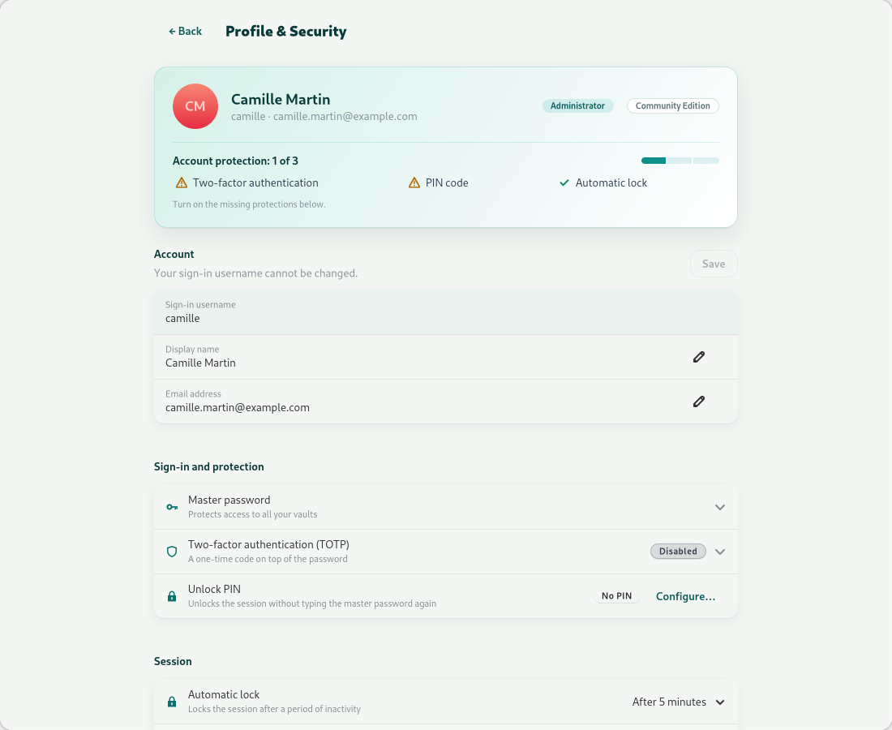

To change the master password, enter your current password, the new one and its confirmation. After success, check the PIN status: it remains valid if the account key has not changed; if the application reports that it was disabled after a key change, configure it again.

### Lock and use a PIN

- Choose automatic locking after **1, 5 or 30 minutes** of inactivity. **Never** disables it after a warning; avoid this setting on a computer left unattended.
- Configure and confirm a **4–8 digit PIN** for quick unlock.
- The PIN protects a key cache **only in memory**, never saved to disk. It does not replace the master password after starting the application again.
- The cache expires no later than **12 hours after creation**; unlocking does not extend that deadline. After **3 wrong attempts**, the cache is deleted and a full sign-in is required.
- With a valid cache, automatic locking and the sign-out action can display the PIN screen. To return to full sign-in, choose **Use master password** there; to exit, use the quit-application action.

A PIN is neither a recovery phrase nor a backup. Do not rely on it after closing the application.

### Enable two-factor authentication

In **Two-factor authentication (TOTP)**:

1. Choose **Enable**.
2. Scan the QR code with your authenticator app, or enter the Base32 secret.
3. Enter a **6-digit** code to confirm activation.

Keep safe access to your authenticator. The QR code and Base32 secret are sensitive. Disabling two-factor authentication requires confirmation in the profile.

### Prepare for account recovery

Distinguish these three items:

| Item | Used to… | Does not replace… |
| --- | --- | --- |
| Master password | Sign in to your account normally | A backup of your data |
| 24-word recovery phrase | Decrypt the matching backup and enable recovery of the account key it contains | The `.hvb` file itself |
| `.hvb` backup | Keep an encrypted snapshot of the database | The phrase needed to open it |

The phrase alone cannot recreate a lost database. The sign-in workflow **restores a backup** and sets a new password; it is not an in-place password reset of the current account.

If the application says a phrase needs to be reattached to the account key, follow its instruction to export from the profile. An administrator can then produce a new recoverable backup. Keep phrases associated with their backups.

## Import, back up and restore

### Import passwords from CSV

From **Profile & Security → Data → CSV import**:

1. Select a CSV whose header contains these **seven columns**, each present even when some values are empty:

   ```csv
   name,url,username,password,notes,category,tags
   Demo portal,https://example.com,alice-demo,fictitious-password,Example,Work,demo
   ```

2. Check the preview and explicitly select the **destination vault**, where you need write permission.
3. Confirm the import and wait for progress to finish.
4. Read the summary: imported rows, failures and reasons. Fix only rejected rows before retrying.

This import creates **Password** entries, not all four secret types. The `name`, `username` and `password` fields must be filled in. Limits are **10 MiB** and **10,000 data rows**. Exports from other managers may need their columns adapted; their native formats are not automatically accepted.

Processing tolerates individual row errors: some entries may already have been created despite failures. Reimporting the whole file can create duplicates. Some structural rejections produce a `csv_import_rejects_*.txt` report in the log directory; the summary provides its path when available.

**The CSV contains plaintext secrets.** Protect it during transfer, then remove unnecessary copies and account for system backups.

### Export an encrypted backup

Exporting `.hvb` is restricted to the **administrator** role in both Community and Professional. It covers **the whole database**, not just the active vault or displayed entries.

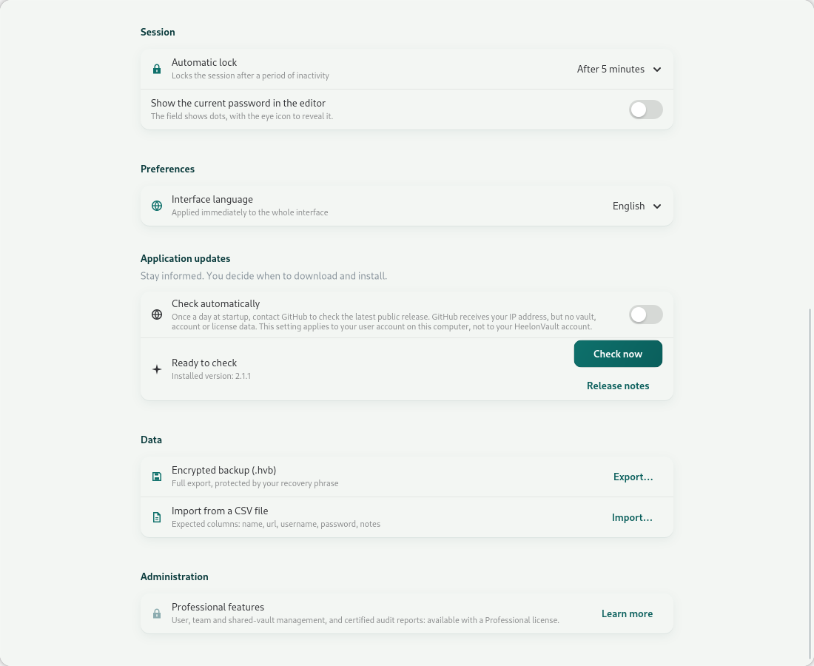

1. In your profile, open **Encrypted backup (.hvb)**.
2. Follow phrase verification: if one already exists, the application asks you to re-enter it; otherwise, it offers to generate a new one for you to record.
3. Choose the destination file and wait for confirmation of success.
4. Keep the file and phrase on separate, safe media. Export fresh backups regularly.

If a new phrase is generated, do not assume an old one will open future exports. Keep the old file/phrase associations for backups already created.

Copying, printing or saving the phrase as TXT creates another sensitive copy: the TXT file is not an encrypted backup. An `.hvb` export does not include files merely referenced by **Secure document** entries.

### Restore and choose a new password

**Warning: this workflow replaces the database used by the application; it does not merge secrets.** Preserve current data before continuing. Changes made after the backup will not be recovered.

1. On the sign-in screen, choose **Restore my database (.hvb)**.
2. Select the backup and enter its **24-word** phrase.
3. Choose and confirm a strong new master password.
4. Choose **Restore and restart**, then sign in after the restart.
5. Read any warnings about unreadable secrets or skipped vaults. Also check two-factor authentication: it may be preserved; if the application reports that it was disabled, enable it again.

Recovery with a new password supports backups **containing a single account**. A multi-account backup can be exported, but this sign-in workflow does not support it. An account-key-format backup must also contain its recovery envelope; knowing a phrase does not make an older file without that envelope recoverable.

Restoration is prepared in a separate database before replacement. An incorrect phrase, altered file or incompatible format produces an error: do not delete the original or repeatedly experiment on irreplaceable data.

## Administer with Professional

The **Professional** edition and **administrator** role are separate requirements. A Professional license does not turn a standard user into an administrator.

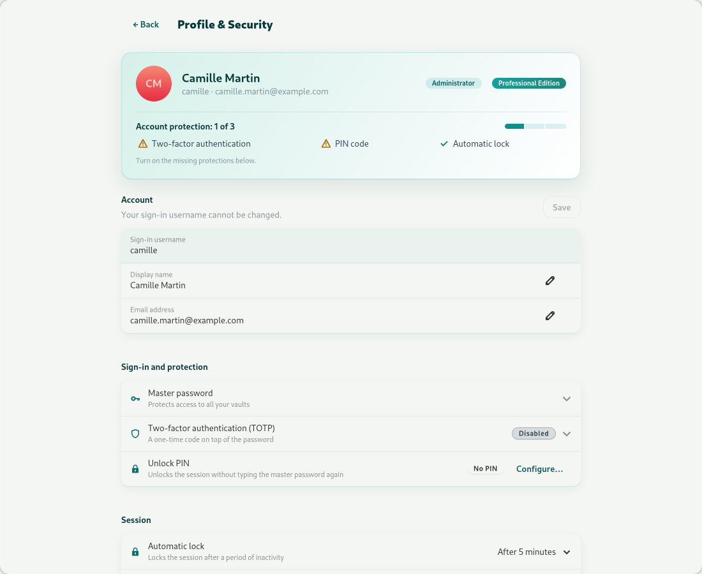

From administration entries in the profile or navigation:

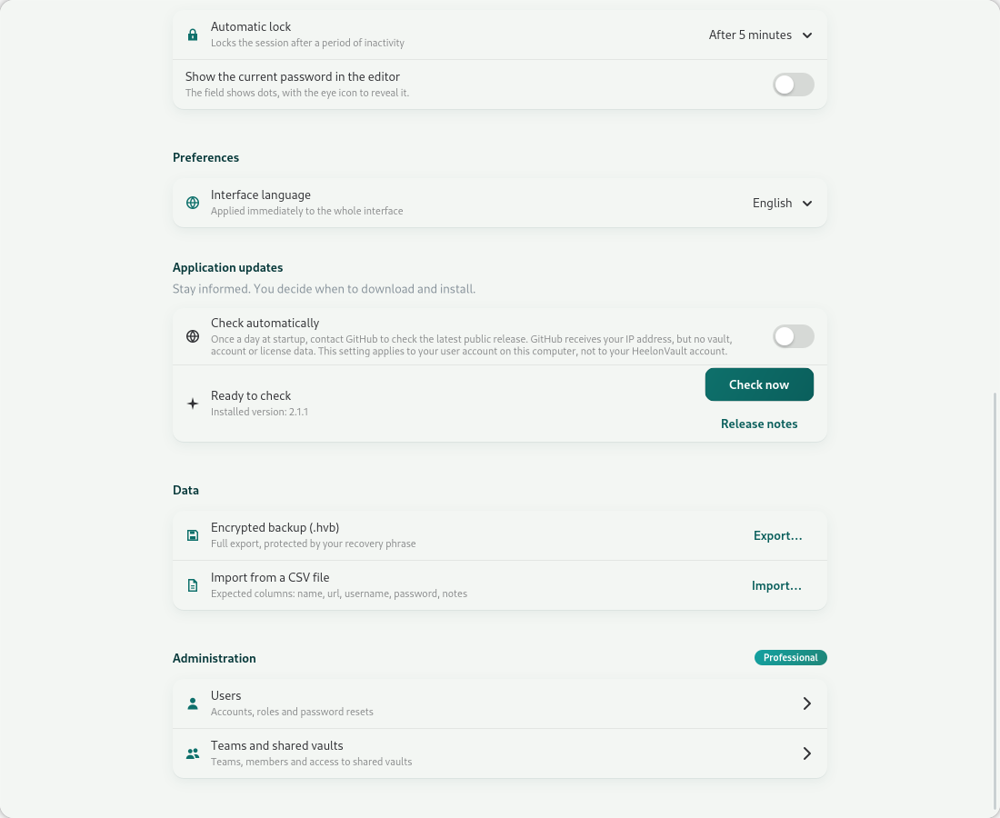

- **Users:** manage accounts and roles, and use the password actions offered.
- **Teams:** organize members and shared access.
- **Audit and reports:** use the functions available for your license and permissions.

Do not confuse permission levels:

| Level | Scope |
| --- | --- |
| Account **User / Administrator** | Global administration; exporting the entire database is restricted to administrators. |
| Team **Leader / Member** | Leaders manage membership; this does not grant the global administrator role. |
| Vault sharing **Read / Write / Admin** | View; view and edit; administer sharing and vault operations. Owners retain their permissions. |

Sharing permissions require a real access path to the vault, directly or through a team. A global role does not mean a missing cryptographic key can be recreated. If an action is missing or denied, check the activated edition, account role and resource permissions.

In Community, an administrator may see a locked presentation of Professional: it is not active access to multi-user features.

## Manage updates and optional networking

### Check for an update

In **Profile & Security → Application updates**, choose **Check now**. Manual checks work even when automatic checks are disabled.

If you allow them, automatic checks contact GitHub at startup, **at most once a day**. The setting applies to your user account on this computer (each user of a shared computer decides for themselves), not to your HeelonVault account. GitHub receives your IP address, but this check sends no vault, account or license data.

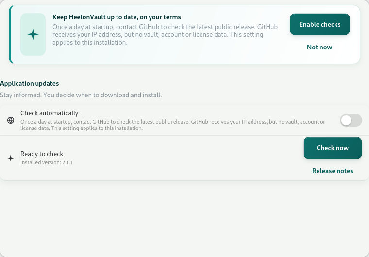

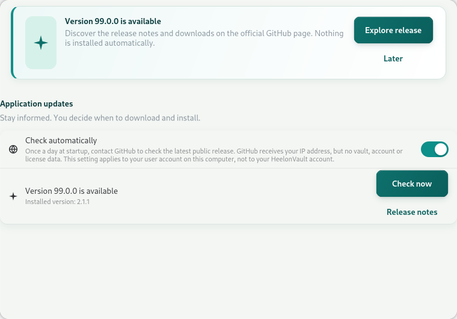

The version displayed in this screenshot is **simulated for testing**: it does not announce an actual release.

When an update is offered, open the official release notes and downloads, then use the installation method appropriate for your system. **This workflow does not automatically download and install anything.** Back up before replacing the application.

### Understand URL checks

Local URL diagnostics highlight issues such as HTTP, invalid syntax or an internationalized domain. **HTTPS does not prove a site is trustworthy.**

In the editor, an online DNS/TLS check is optional and requests consent **for each check**. The DNS resolver and destination server may observe the domain and your IP address. The check contacts the host, not the page: it sends no path, query parameters, secret, cookie or login. Internal addresses are blocked.

A valid TLS certificate guarantees neither the site's reputation nor the page's existence. A network failure is not proof that a domain is malicious. The security center does not make these connections.

External links, opening a URL and any configured federated-authentication functions are other explicit network actions. Local secret-management tasks do not require URL or update checks to be enabled.

## Troubleshoot

| Problem | Checks and action |
| --- | --- |
| Sign-in refused | Check username, keyboard layout and password; respect any delay after failed attempts. For TOTP, check the phone's clock and use a fresh code. |
| PIN refused or missing after restart | It is limited to the in-memory session. Use the master password; after three failures or expiry, configure it again once signed in. |
| Session locks too quickly | Adjust the profile timeout rather than disabling protection. |
| Secret missing | Check active vault, MultiVault, search, filters and trash. Revoked sharing may also remove your access. |
| Partially successful import | Review the summary, seven-column format and target-vault permissions. Reimport only rows not already created. |
| Decryption error during import | Check the selected vault and access to its keys; this message does not necessarily mean the CSV is invalid. Do not reset the database to work around it. |
| Phrase rejected during restore | Use the phrase associated with that file, in the correct order. Also check format, integrity and the single-account limit. The phrase alone is insufficient. |
| Update check unavailable | Check connectivity and try later; local operations remain available. |

To identify your installation, use the **About** dialog, or these commands if the binary is accessible from your terminal:

```sh
heelonvault --version
heelonvault --startup-check
```

`--version` prints the installed version without opening the database or interface. `--startup-check` initializes services and applies normal migrations, then exits without opening the interface: **it is not a read-only diagnostic**. Use it with the same installation and correct database; there is no restore command here to substitute for the graphical workflow.

Before sharing logs with support, remove sensitive information. Never attach your master password, recovery phrase, TOTP QR code, private key or a CSV containing secrets.

### Further reading

- [Installation and quickstart](QUICKSTART.md)
- [Architecture and data model](ARCHITECTURE.en.md)
- [Security guide](../SECURITY.md)
