# Guide utilisateur

Langue : FR | [EN](USER_GUIDE.en.md)

HeelonVault conserve vos secrets dans une base locale. Ce guide suit les tâches du quotidien ; les actions visibles dépendent de votre rôle, des droits sur le coffre et de l'édition activée.

Les captures montrent les **vrais composants de production sous Linux**, montés dans des scénarios de test avec une base de démonstration et des données fictives, pas dans une session utilisateur réelle. Les vues de coffre et d'édition illustrent leurs composants, sans reproduire nécessairement toute la fenêtre ni tous les éléments de son en-tête. L'apparence, les sélecteurs de fichiers et certaines intégrations peuvent différer sous Windows et macOS : ces captures ne constituent pas une validation sur ces plateformes.

## Démarrer

1. Ouvrez HeelonVault depuis le lanceur de votre système.
2. Au premier démarrage, suivez l'assistant pour créer le compte administrateur initial et choisir un mot de passe maître fort.
3. Notez la **phrase de récupération de 24 mots**, dans l'ordre, sur un support sûr séparé de votre ordinateur. Ne la partagez pas.
4. Terminez l'assistant, puis connectez-vous avec le compte créé. La création du compte n'ouvre pas automatiquement une session.
5. Sélectionnez un coffre ou créez-en un avant d'ajouter vos secrets.
6. Depuis **Profil & Sécurité**, exportez une sauvegarde chiffrée `.hvb` et conservez-la hors de cet ordinateur.

**À préparer dès maintenant :** la phrase protège la récupération, mais ne contient pas vos données. Pour le parcours de récupération proposé à la connexion, il faut **le fichier `.hvb` et la phrase qui lui correspond**. Voir [Sauvegarder et restaurer](#importer-sauvegarder-et-restaurer).

Aux connexions suivantes, saisissez votre identifiant et votre mot de passe maître. Si la double authentification est activée, fournissez aussi le code TOTP de votre application d'authentification.

## Se repérer dans l'interface

- **Barre latérale :** sélectionner un coffre, accéder à la corbeille, au centre de sécurité et au profil ; les entrées d'administration dépendent de vos droits.
- **Zone centrale :** rechercher, filtrer, trier et consulter les secrets du périmètre sélectionné.
- **Commandes de la fenêtre :** ajouter un secret, changer l'affichage et suivre l'exposition liée au presse-papiers ; tous ces éléments ne figurent pas nécessairement dans les captures de composants.
- **Pages d'édition et de profil :** travailler sans perdre la navigation latérale, puis revenir aux entrées.

Les modes **cartes** et **liste** affichent les mêmes secrets et conservent la logique de recherche et de filtrage. Choisissez les cartes pour parcourir visuellement, la liste pour une vue plus compacte.

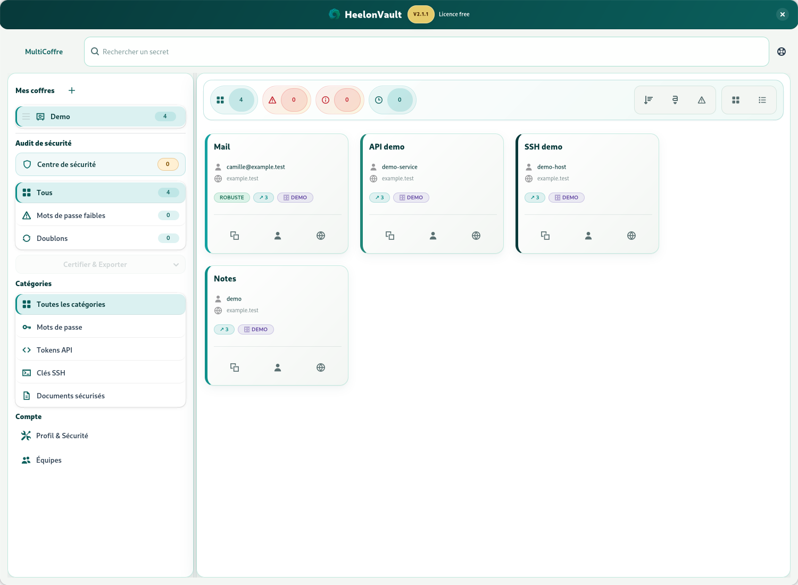

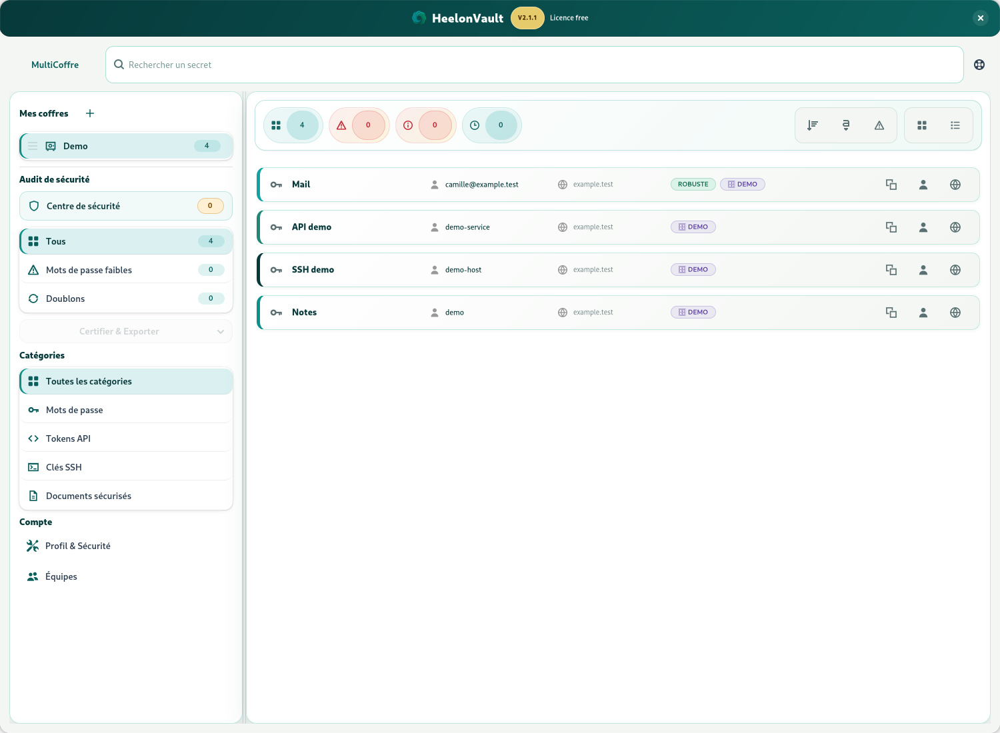

## Créer et utiliser les quatre types de secrets

### Ajouter une entrée

1. Choisissez le coffre de destination, puis l'action d'ajout.
2. Sélectionnez le type et renseignez le titre ainsi que la valeur requise.
3. Complétez les champs utiles : identifiant, URL, notes, catégorie, tags ou validité, selon le formulaire.
4. Enregistrez, puis vérifiez que l'entrée apparaît dans le bon coffre.

| Type | À renseigner | Point d'attention |
| --- | --- | --- |
| **Mot de passe** | Mot de passe, identifiant et informations du compte | Utilisez le générateur et l'indicateur de robustesse ; préférez une valeur unique par service. |
| **Token API** | Token et fournisseur | Modifier le token dans HeelonVault ne le renouvelle pas chez le fournisseur. |
| **Clé SSH** | Clé privée ; clé publique et phrase secrète si nécessaires | Ne confondez pas la clé publique à distribuer avec la clé privée à protéger. |
| **Document sécurisé** | Chemin du document et type MIME éventuel | Le formulaire actuel enregistre le **chemin comme valeur secrète**, pas le contenu du fichier. Ce n'est pas une pièce jointe chiffrée ni une sauvegarde du document. |

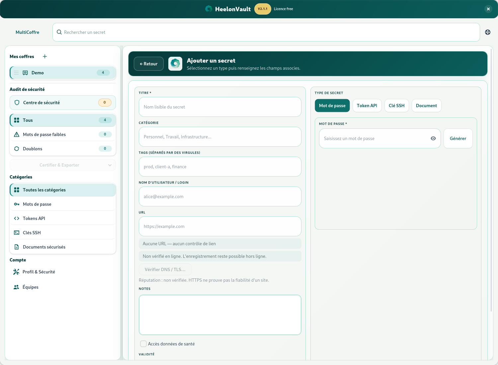

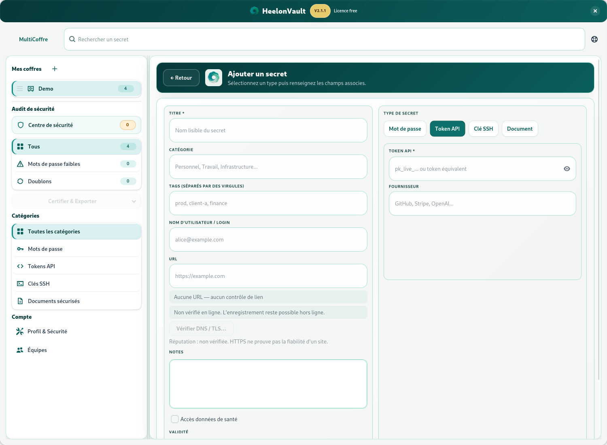

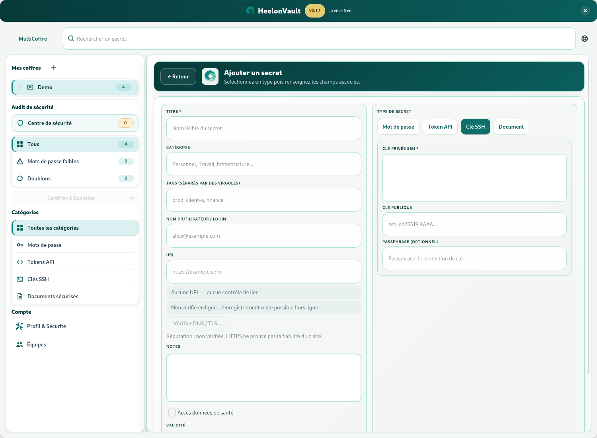

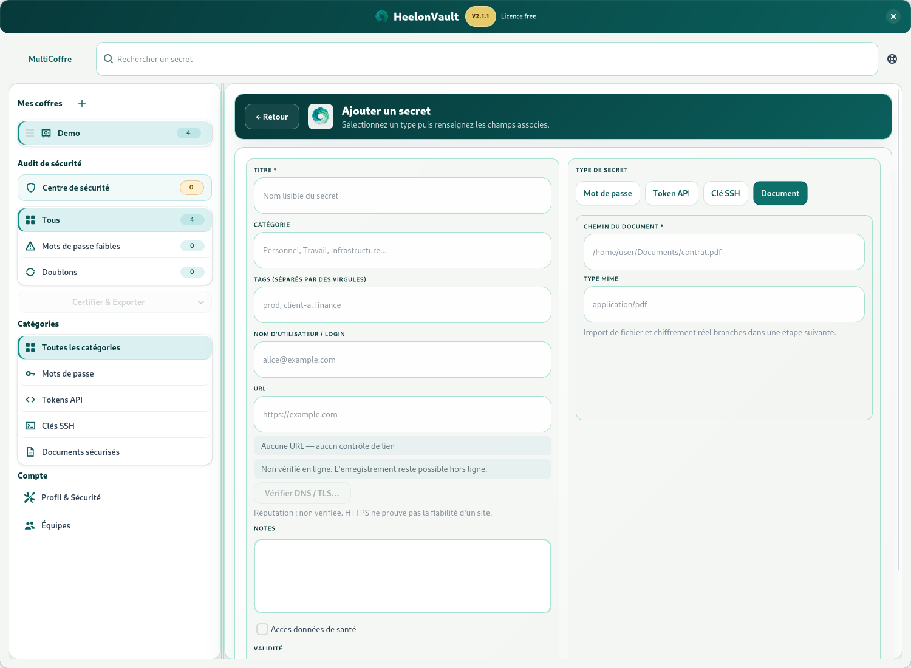

### Consulter, copier et modifier

Ouvrez une entrée pour la modifier. Utilisez les actions de copie plutôt que d'afficher durablement une valeur sensible. La copie d'un mot de passe le déchiffre à la demande et revérifie l'accès au coffre.

L'indicateur du presse-papiers signale les copies suivies par HeelonVault et leur délai d'effacement ; cliquez dessus pour effacer immédiatement. Il ne garantit ni l'absence de secrets ailleurs en mémoire, ni l'effacement des historiques de presse-papiers ou des copies déjà effectuées par d'autres applications.

Une date de validité aide à repérer les entrées à renouveler : elle ne révoque pas les identifiants chez le service externe. Changez d'abord le secret sur ce service, puis mettez l'entrée à jour.

### Supprimer ou retrouver une entrée supprimée

Une suppression place le secret dans la **corbeille**. Ouvrez-la pour restaurer l'entrée ou la supprimer définitivement. **Vider la corbeille** est irréversible dans la base courante ; une éventuelle sauvegarde antérieure constitue un autre recours.

## Rechercher et organiser

La recherche porte par défaut sur le **coffre actif**. Activez **MultiCoffre** pour chercher dans les coffres auxquels vous avez accès. Une recherche ne donne aucun droit supplémentaire.

Les termes simples recherchent dans le titre, l'identifiant, l'e-mail, l'URL, les notes, la catégorie, les tags, le type et le nom du coffre. La recherche ignore la casse et normalise notamment les accents courants ; une légère tolérance aux fautes s'applique aux termes suffisamment longs. Elle ne recherche pas dans les valeurs secrètes déchiffrées.

| Exemple | Usage |
| --- | --- |
| `messagerie` | Retrouver un terme dans les informations de l'entrée |
| `email:exemple.fr` | Limiter le terme au champ e-mail |
| `tag:travail` | Chercher dans les tags |
| `type:api` | Chercher un type de secret |
| `coffre:équipe` | Restreindre au nom du coffre dans le périmètre chargé |
| `title:portail login:alice` | Combiner des critères |
| `#sante` ou `#health` | Retrouver les accès liés à la santé (services médicaux, assurance maladie…), pas les alertes de sécurité |

Les préfixes `url:`, `notes:` et `category:` sont également disponibles. Combinez la recherche avec les filtres, le tri et le choix du coffre ; en cas de résultat vide, retirez d'abord les filtres et vérifiez le périmètre.

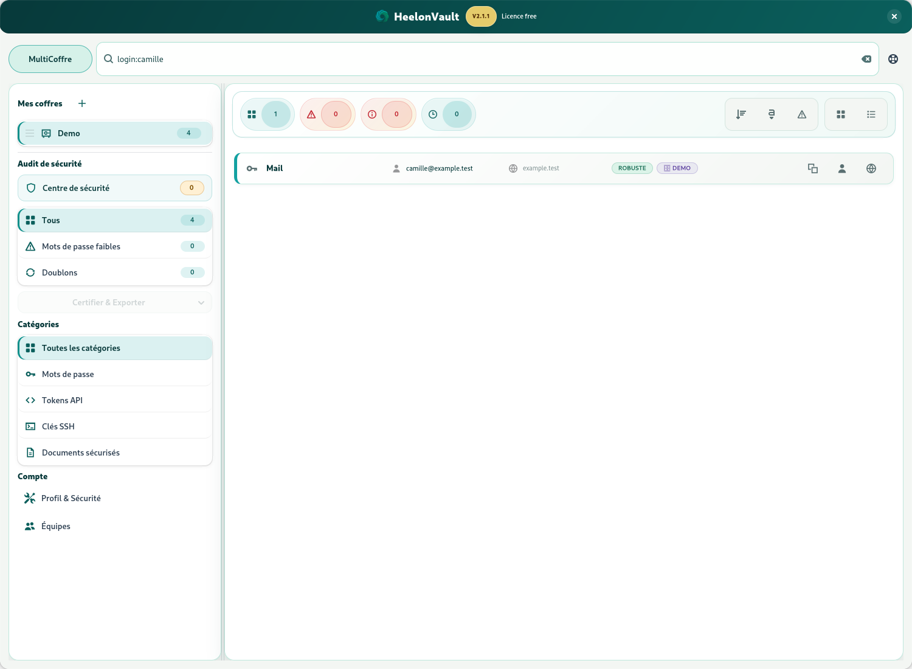

**Raccourcis :** `Ctrl+F` place le curseur dans la recherche. Quand la liste des secrets a le focus, les flèches déplacent la sélection ; `Ctrl+C` copie le mot de passe, `Ctrl+L` l'identifiant et `Ctrl+U` ouvre l'URL lorsque l'action existe. La touche Commande peut remplacer Ctrl selon la plateforme. Ces actions ne doivent pas détourner la saisie dans un formulaire.

## Examiner le centre de sécurité

1. Ouvrez le **Centre de sécurité**.
2. Lancez **Analyser mes coffres** ; vous pouvez annuler l'analyse.
3. Consultez les constats, leur coffre d'origine et la couverture de l'analyse.
4. Ouvrez une entrée concernée pour préparer la correction, puis relancez l'analyse après modification.

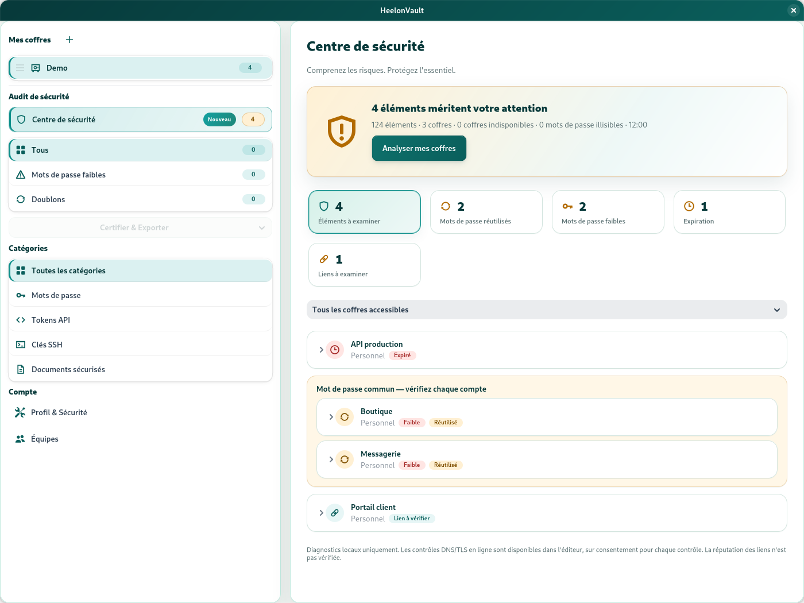

Le centre de sécurité illustré utilise un scénario de démonstration distinct de celui du coffre. Ses constats ne correspondent donc pas aux compteurs des captures du coffre, qui peuvent afficher zéro ; il ne s'agit pas d'une même analyse avant et après correction.

L'analyse est **locale, sans requête réseau**, sur les coffres accessibles. Elle repère notamment les mots de passe faibles ou réutilisés, les expirations dépassées ou proches, les dates ou métadonnées invalides, les valeurs illisibles et les URL nécessitant votre attention.

Un coffre indisponible ou un mot de passe illisible rend la couverture incomplète : cela ne signifie pas que les données manquantes sont saines. L'absence de constat n'est ni une preuve d'absence de compromission, ni une certification de conformité.

Pour corriger un mot de passe réutilisé, un token expiré ou une clé exposée, **effectuez d'abord le changement ou la révocation sur le service concerné**, puis actualisez HeelonVault. Changer seulement l'entrée locale ne protège pas le compte distant.

## Gérer le compte, la session et la récupération

### Régler le profil

Ouvrez **Profil & Sécurité** pour modifier les informations proposées, changer le mot de passe maître, choisir la langue et régler les protections. L'identifiant de connexion n'est pas modifiable. La langue s'applique immédiatement à l'interface.

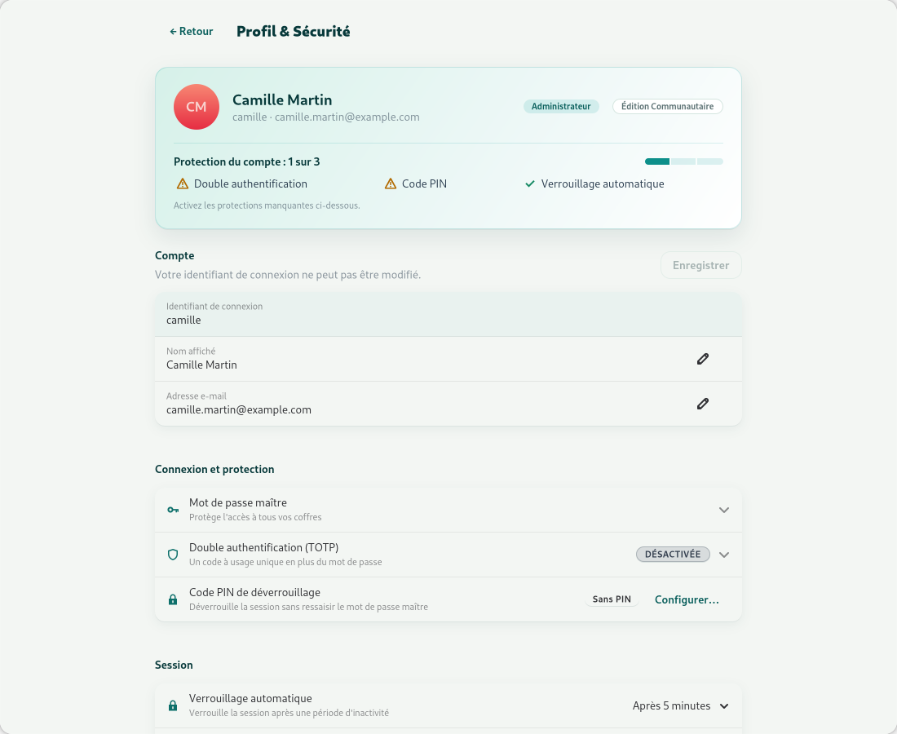

Pour changer le mot de passe maître, saisissez le mot de passe actuel, le nouveau et sa confirmation. Après réussite, vérifiez le statut du PIN : il reste valide si la clé du compte n'a pas changé ; si l'application annonce sa désactivation après un changement de clé, configurez-le à nouveau.

### Verrouiller et utiliser le PIN

- Choisissez un verrouillage automatique après **1, 5 ou 30 minutes** d'inactivité. **Jamais** le désactive après avertissement ; évitez ce réglage sur un poste laissé sans surveillance.
- Configurez un **PIN de 4 à 8 chiffres**, confirmé deux fois, pour le déverrouillage rapide.
- Le PIN protège un cache de clé **uniquement en mémoire**, jamais enregistré sur disque. Il ne remplace pas le mot de passe maître pour un nouveau démarrage.
- Le cache expire au plus tard **12 heures après sa création** ; les déverrouillages ne prolongent pas ce délai. Après **3 erreurs**, il est supprimé et la connexion complète est requise.
- Avec un cache valide, le verrouillage automatique et l'action de déconnexion peuvent afficher l'écran PIN. Pour revenir à la connexion complète, choisissez **Utiliser le mot de passe maître** sur cet écran ; pour quitter, utilisez l'action de fermeture de l'application.

Un PIN n'est ni une phrase de récupération ni une sauvegarde. Ne comptez pas dessus après fermeture de l'application.

### Activer la double authentification

Dans la section **Authentification à deux facteurs (TOTP)** :

1. Choisissez **Activer**.
2. Scannez le QR code avec votre application d'authentification, ou saisissez le secret Base32.
3. Entrez un code à **6 chiffres** pour confirmer l'activation.

Conservez un accès sûr à votre authentificateur. Le QR code et le secret Base32 sont sensibles. La désactivation demande une confirmation dans le profil.

### Préparer une récupération de compte

Distinguez ces trois éléments :

| Élément | Sert à… | Ne remplace pas… |
| --- | --- | --- |
| Mot de passe maître | Ouvrir normalement votre compte | Une sauvegarde des données |
| Phrase de récupération de 24 mots | Déchiffrer la sauvegarde correspondante et permettre la récupération de la clé du compte qu'elle contient | Le fichier `.hvb` lui-même |
| Sauvegarde `.hvb` | Conserver un instantané chiffré de la base | La phrase nécessaire pour l'ouvrir |

La phrase seule ne recrée pas une base perdue. Le parcours disponible à la connexion **restaure une sauvegarde** et fixe un nouveau mot de passe ; ce n'est pas une réinitialisation sur place du compte courant.

Si l'application signale qu'une phrase doit être rattachée à la clé du compte, suivez l'instruction d'export depuis le profil. Un administrateur peut ainsi produire une nouvelle sauvegarde récupérable. Gardez les phrases associées à leurs sauvegardes.

## Importer, sauvegarder et restaurer

### Importer des mots de passe depuis un CSV

Depuis **Profil & Sécurité → Données → Import CSV** :

1. Choisissez un CSV dont l'en-tête contient les **sept colonnes** suivantes, chacune présente même si certaines valeurs sont vides :

   ```csv
   name,url,username,password,notes,category,tags
   Portail démo,https://example.com,alice-demo,mot-de-passe-fictif,Exemple,Travail,demo
   ```

2. Vérifiez l'aperçu et choisissez explicitement le **coffre de destination**, sur lequel vous devez disposer des droits d'écriture.
3. Confirmez l'import et attendez la progression.
4. Lisez le bilan : lignes importées, échecs et raisons. Corrigez seulement les lignes rejetées avant de réessayer.

Cet import crée des entrées **Mot de passe**, pas les quatre types de secrets. Les champs `name`, `username` et `password` doivent être renseignés. Les limites sont **10 Mio** et **10 000 lignes de données**. Un export d'un autre gestionnaire peut nécessiter une adaptation des colonnes ; il n'est pas accepté automatiquement dans son format d'origine.

Le traitement tolère des erreurs par ligne : une partie des entrées peut déjà être créée malgré des échecs. Relancer tout le fichier peut créer des doublons. Certains rejets de structure produisent un rapport `csv_import_rejects_*.txt` dans le répertoire des journaux ; le bilan indique son chemin lorsqu'il existe.

**Le CSV contient des secrets en clair.** Protégez-le pendant le transfert, puis supprimez les copies inutiles et tenez compte des sauvegardes du système.

### Exporter une sauvegarde chiffrée

L'export `.hvb` est réservé au rôle **administrateur**, en Community comme en Professional. Il couvre **toute la base**, pas seulement le coffre actif ni les seules entrées affichées.

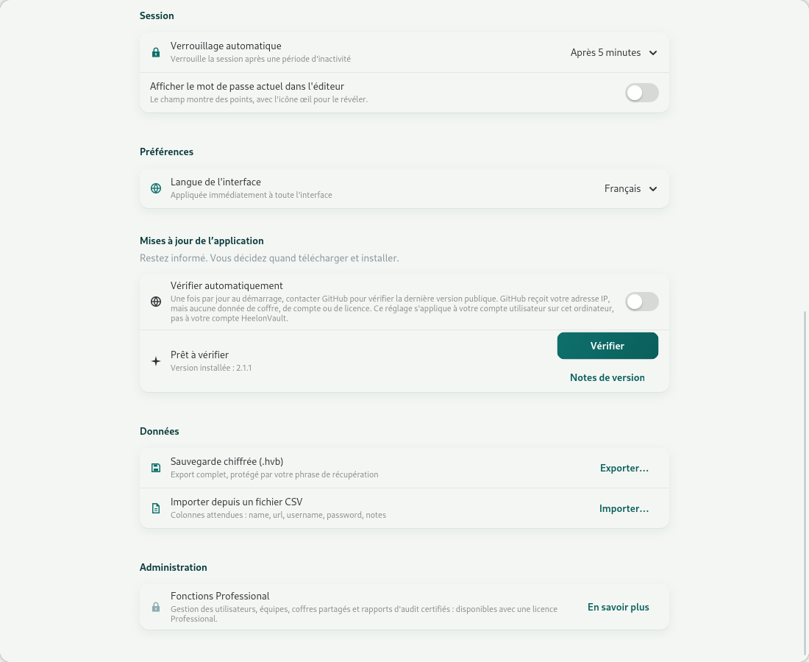

1. Dans le profil, ouvrez **Sauvegarde chiffrée (.hvb)**.
2. Suivez la vérification de la phrase : si elle existe déjà, l'application vous demande de la ressaisir ; sinon, elle propose d'en générer une nouvelle à consigner.
3. Choisissez le fichier de destination et attendez la confirmation de réussite.
4. Conservez le fichier et sa phrase sur des supports séparés et sûrs. Faites régulièrement de nouveaux exports.

Si une nouvelle phrase est générée, ne présumez pas qu'une ancienne ouvrira les futurs exports. Gardez les anciennes associations fichier/phrase pour les sauvegardes déjà créées.

Copier, imprimer ou enregistrer la phrase en TXT crée une autre copie sensible : le TXT n'est pas une sauvegarde chiffrée. Un export `.hvb` ne contient pas les fichiers simplement référencés par les entrées **Document sécurisé**.

### Restaurer et choisir un nouveau mot de passe

**Attention : ce parcours remplace la base utilisée par l'application ; il ne fusionne pas les secrets.** Préservez les données actuelles avant de continuer. Les changements postérieurs à la sauvegarde ne seront pas récupérés.

1. Depuis l'écran de connexion, choisissez **Restaurer ma base (.hvb)**.
2. Sélectionnez la sauvegarde et entrez sa phrase de **24 mots**.
3. Choisissez un nouveau mot de passe maître fort et confirmez-le.
4. Lancez **Restaurer et redémarrer**, puis reconnectez-vous après redémarrage.
5. Lisez les avertissements éventuels sur les secrets illisibles ou les coffres ignorés. Vérifiez aussi l'état de la double authentification : elle peut être conservée ; si l'application annonce sa désactivation, réactivez-la.

La récupération avec nouveau mot de passe prend en charge les sauvegardes **contenant un seul compte**. Une sauvegarde multi-comptes peut être exportée, mais n'est pas prise en charge par ce parcours de connexion. Une sauvegarde de compte au format à clé de compte doit aussi contenir son enveloppe de récupération ; un ancien fichier qui en est dépourvu ne devient pas récupérable simplement parce que vous connaissez une phrase.

La restauration est préparée dans une base distincte avant remplacement. Une phrase incorrecte, un fichier altéré ou un format incompatible provoque une erreur : ne supprimez pas l'original et ne multipliez pas les essais sur des données irremplaçables.

## Administrer avec Professional

L'édition **Professional** et le rôle **administrateur** sont deux conditions distinctes. Une licence Professional ne transforme pas un utilisateur standard en administrateur.

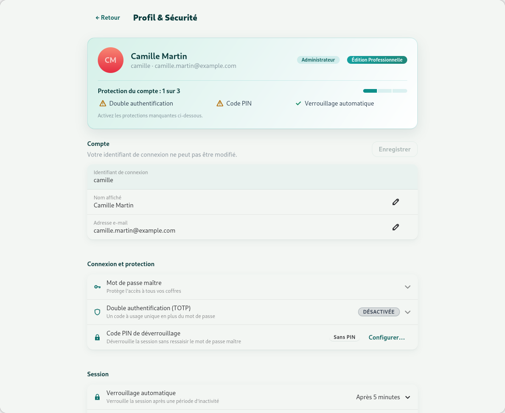

Depuis les entrées d'administration du profil ou de la navigation :

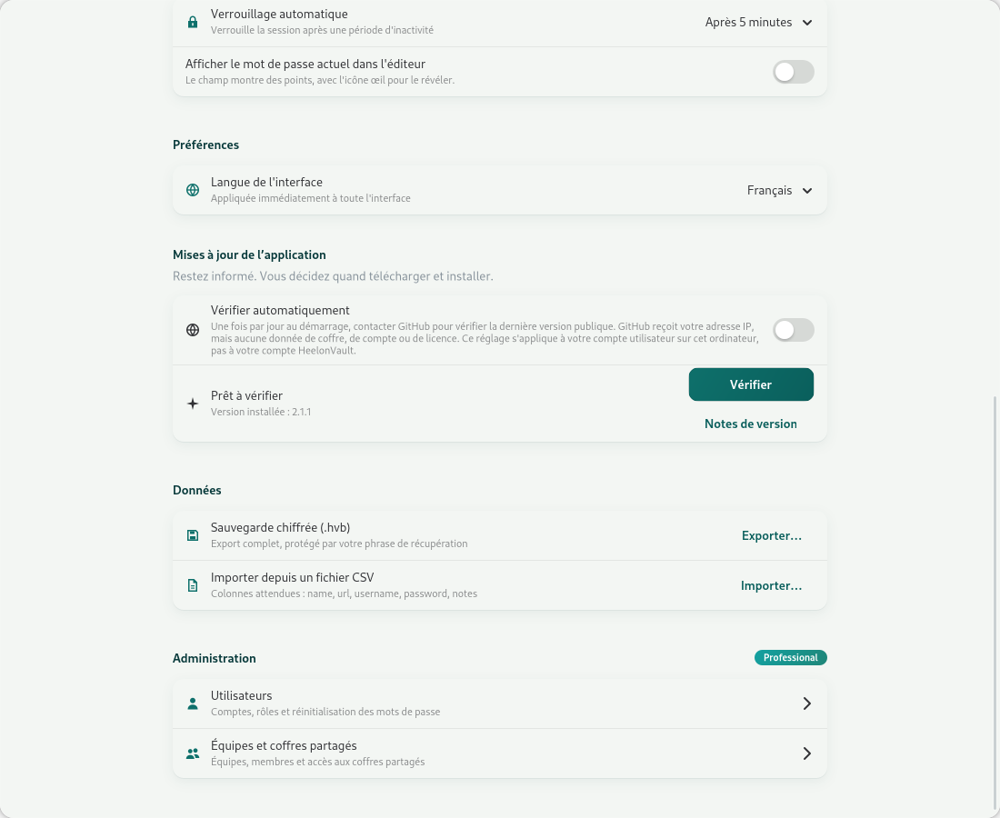

- **Utilisateurs :** gérer les comptes et leurs rôles, et utiliser les actions de mot de passe proposées.
- **Équipes :** organiser les membres et les accès partagés.
- **Audit et rapports :** consulter les fonctions disponibles pour votre licence et vos droits.

Ne confondez pas les niveaux d'autorisation :

| Niveau | Portée |
| --- | --- |
| **Utilisateur / Administrateur** du compte | Administration globale ; l'export complet de la base est réservé à l'administrateur. |
| **Responsable / Membre** d'équipe | Gestion des membres pour le responsable ; cela ne donne pas le rôle administrateur global. |
| **Lecture / Écriture / Administration** du partage de coffre | Consulter ; consulter et modifier ; administrer notamment les partages et opérations du coffre. Le propriétaire conserve ses droits. |

Les droits de partage supposent un accès réel au coffre, direct ou par équipe. Un rôle global ne signifie pas qu'une clé cryptographique manquante peut être recréée. Si une action est absente ou refusée, vérifiez à la fois l'édition activée, le rôle du compte et les droits sur la ressource.

En Community, l'administrateur peut voir une présentation verrouillée de Professional : ce n'est pas un accès actif aux fonctions multi-utilisateurs.

## Gérer les mises à jour et le réseau facultatif

### Chercher une mise à jour

Dans **Profil & Sécurité → Mises à jour**, choisissez **Vérifier maintenant**. La vérification manuelle fonctionne même si les vérifications automatiques sont désactivées.

Si vous les autorisez, les vérifications automatiques contactent GitHub au démarrage, **au plus une fois par jour**. Le réglage s'applique à votre compte utilisateur sur cet ordinateur (chaque utilisateur d'un poste partagé décide pour lui-même), pas à votre compte HeelonVault. GitHub reçoit votre adresse IP, mais aucune donnée de coffre, de compte ou de licence n'est envoyée par cette vérification.

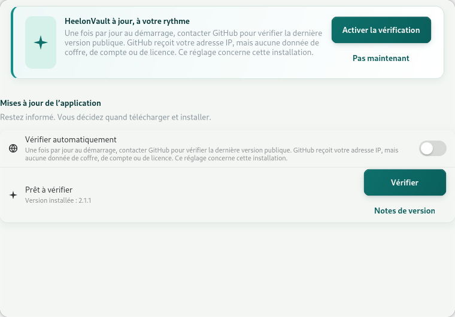

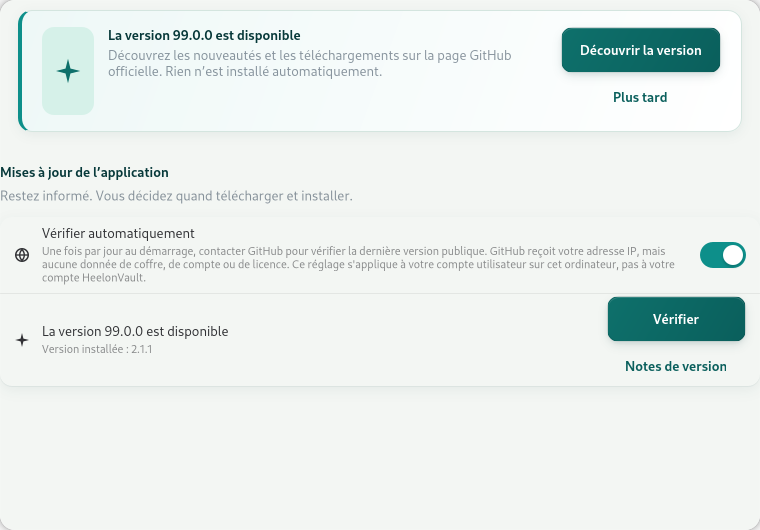

La version affichée dans cette capture est **simulée pour le test** : elle n'annonce aucune publication réelle.

Quand une mise à jour est proposée, ouvrez les notes et téléchargements de la publication officielle, puis utilisez le mode d'installation adapté à votre système. **Rien n'est téléchargé et installé automatiquement par ce parcours.** Faites une sauvegarde avant de remplacer l'application.

### Comprendre les contrôles d'URL

Le diagnostic local d'une URL signale par exemple HTTP, une syntaxe invalide ou un domaine internationalisé. **HTTPS ne prouve pas qu'un site est digne de confiance.**

Dans l'éditeur, un contrôle en ligne DNS/TLS est facultatif et demande votre accord **pour chaque contrôle**. Le résolveur DNS et le serveur cible peuvent observer le domaine et votre adresse IP. Le contrôle contacte l'hôte, pas la page : il n'envoie ni chemin, ni paramètres, ni secret, ni cookie, ni identifiant. Les adresses internes sont bloquées.

Un certificat TLS valide ne garantit ni la réputation du site, ni l'existence de la page. Une erreur réseau ne prouve pas que le domaine est malveillant. Le centre de sécurité n'effectue pas ces connexions.

Les liens externes, l'ouverture d'une URL et les fonctions d'authentification fédérée éventuellement configurées constituent d'autres actions réseau explicites. Les tâches locales sur vos secrets ne nécessitent pas d'activer les contrôles d'URL ou de mises à jour.

## Dépanner

| Problème | Vérifications et action |
| --- | --- |
| Connexion refusée | Vérifiez l'identifiant, la disposition du clavier et le mot de passe ; respectez un éventuel délai après échecs. Pour TOTP, vérifiez l'heure du téléphone et utilisez un code récent. |
| PIN refusé ou absent après redémarrage | Il est limité à la session en mémoire. Utilisez le mot de passe maître ; après trois erreurs ou expiration, configurez-le à nouveau une fois connecté. |
| Verrouillage trop rapide | Ajustez le délai dans le profil plutôt que de désactiver la protection. |
| Secret introuvable | Vérifiez coffre actif, MultiCoffre, recherche, filtres et corbeille. Un retrait de partage peut aussi supprimer votre accès. |
| Import partiellement réussi | Consultez le bilan, le format des sept colonnes et les droits du coffre cible. Ne réimportez que les lignes non créées. |
| Erreur de déchiffrement à l'import | Vérifiez le coffre choisi et votre accès à ses clés ; ce message n'indique pas nécessairement un CSV invalide. Ne réinitialisez pas la base pour le contourner. |
| Phrase refusée à la restauration | Utilisez la phrase associée à ce fichier, dans le bon ordre. Vérifiez aussi format, intégrité et limite mono-compte. La phrase seule ne suffit pas. |
| Mise à jour indisponible | Vérifiez la connexion et réessayez plus tard ; vos opérations locales restent disponibles. |

Pour identifier l'installation, utilisez le dialogue **À propos**, ou les commandes suivantes si le binaire est accessible dans votre terminal :

```sh
heelonvault --version
heelonvault --startup-check
```

`--version` affiche la version installée sans ouvrir la base ni l'interface. `--startup-check` initialise les services et applique les migrations habituelles, puis quitte sans ouvrir l'interface : **ce n'est pas un diagnostic en lecture seule**. Utilisez-le avec la même installation et la bonne base ; il n'existe pas ici de commande de restauration à substituer au parcours graphique.

Avant de transmettre un journal au support, retirez les informations sensibles. Ne joignez jamais mot de passe maître, phrase de récupération, QR TOTP, clé privée ou CSV contenant vos secrets.

### Pour aller plus loin

- [Installation et démarrage rapide](QUICKSTART.fr.md)
- [Architecture et modèle de données](ARCHITECTURE.md)
- [Guide de sécurité](../SECURITY.fr.md)
